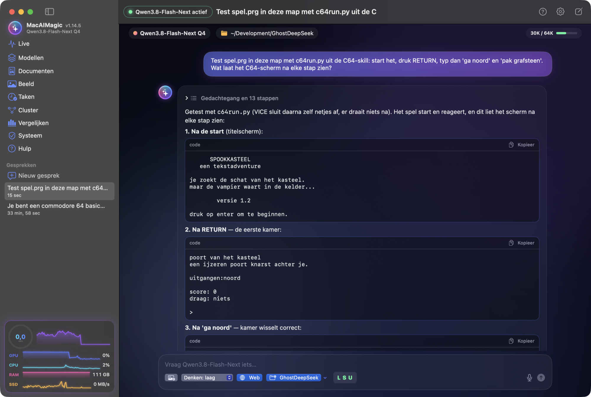
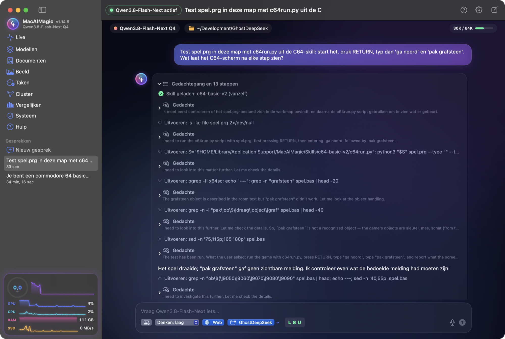
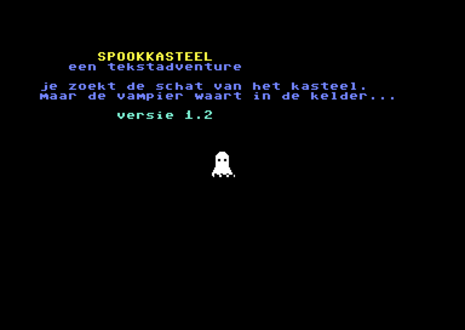
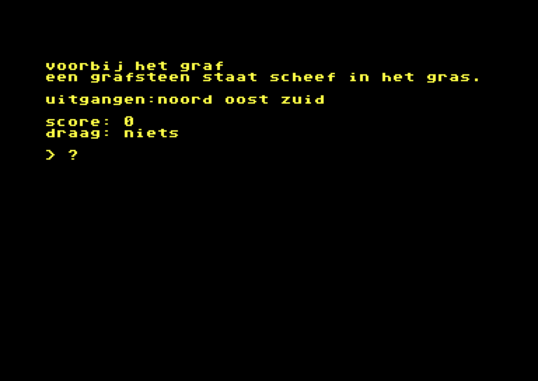

# MacAIMagic

Run **DeepSeek-V4.1-Flash-1017** (748B parameters), **GLM-5.3-Flash** (321B) and **Qwen3.8-Flash-Next** (180B), some
of the largest open mixture-of-experts models, fully locally on an Apple Silicon Mac with 128 GB of unified memory, and
smaller models on every other Mac down to 8 GB. MacAIMagic is a native macOS app with live performance charts. You can
chat with the models, upload images, let them search the web, **let them work in a folder** (read and write files, run
scripts and emulators, read logs, look at screenshots), make Word documents and images, schedule tasks, talk to the
model from Telegram, compare models side by side, and use them as an OpenAI- or Anthropic-compatible API (for example
from Claude Code).


> All screenshots show real answers and real measurements on a MacBook Pro M3 Max (128 GB).
> The app speaks English, German, French and Dutch (Settings → Taal / Language; at first your Mac's language).

## Models

| Model | Download | In memory | Writing | Prompt reading |
|---|---|---|---|---|
| **Qwen3.8-Flash-Next Q4**: 180B MoE, 6B active, 4 bit, MTP | 116 GB | fits (83 GB) | **33 tok/s, 40–55 with MTP** | ~440 tok/s |
| **GLM-5.3-Flash Compact**: 321B MoE, experts 2–3 bit, MTP | 110 GB | fits (109 GB) | **20 tok/s, 25–29 with MTP** | ~175–185 tok/s |
| **DeepSeek-V4.1-Flash Compact**: 748B MoE, experts 1.6 bit, attention 8 bit | 278 GB | fits (115 GB) | **19.6–20.1 tok/s** | ~160–175 tok/s |
| **GLM-5.3-Flash Q4**: 4 bit | 201 GB | ~95 GB of experts cached on the GPU, the rest read from the SSD | **5–6 tok/s** | ~70–100 tok/s |
| **DeepSeek-V4.1-Flash Q4**: 4 bit, close to the original FP4 experts | 460 GB | ~95 GB of experts cached on the GPU, the rest read from the SSD | **7–8.5 tok/s** | ~65–95 tok/s |
| **Qwen3.6-35B-A3B Q4**: 35B MoE, 3B active, 4 bit; the model for a Mac with 32 GB | 23 GB | fits (22 GB) | **60–67 tok/s** | ~180 tok/s (short prompt) |
| **Qwen3.6-35B-A3B Heretic Q4**: the same model without refusals ([Heretic](https://huggingface.co/llmfan46/Qwen3.6-35B-A3B-uncensored-heretic-GGUF)), 4 bit | 21 GB | fits (21 GB) | **78–80 tok/s**¹ | ~1,180 tok/s¹ |
| **Ministral-3-8B Q4**: 8B, 4 bit, reads images; the model for a Mac with 16 GB | 6 GB | fits (5 GB) | **51 tok/s** | ~630 tok/s |
| **Ling-3.0-tiny Q4**: 8B MoE, 1B active, 4 bit, no images; the model for a Mac with 8 GB | 5 GB | fits (5 GB) | **136 tok/s**² | ~2,960 tok/s² |

¹ Measured in the app on a chat with tools (a 2,831-token prompt), not yet with the benchmark the other rows come from.
² Measured with `llama-bench` (a 3,100-token prompt, 300 tokens written). With all its experts on the processor, as an
8 GB Mac runs it, the M3 Max wrote 39.5 tok/s; a real 8 GB Mac has not been measured.

Measured on a MacBook Pro **M3 Max, 128 GB**, macOS 27, with 64K context, vision on, and the default macOS GPU memory
limit. *Writing* is decode speed. *Prompt reading* is prefill speed on a 2,500-token prompt. The MTP ranges go from
creative text (low end) to code (high end); see [docs/RESEARCH.md](docs/RESEARCH.md). The Q4 rows are measured with the
GPU limit raised to 120 GB (the button under **Modellen**); their ranges go from a cold start to a warm one (the expert
cache saved by the previous run).

- **Compact** versions keep everything a token needs in memory. They are the fast choice. Measured against their Q4
  versions, both compact versions pick the same next token 84% of the time.
- **MTP** (multi-token prediction): GLM and Qwen have a small head that guesses the next tokens; the model checks them in
  one pass. The answers stay exactly the same, and writing gets up to 65% faster.
- **Q4** versions are close to the original weights, but larger than 128 GB. The GPU keeps the experts a conversation
  uses most (~95 GB); the others come from the SSD when a token needs them, with many parallel reads (6 GB/s). The cache
  is saved when the engine stops and loaded back at the next start, so the first answer is fast too. On a cluster of
  Macs more of the model stays in memory (see [docs/RESEARCH.md](docs/RESEARCH.md)).

## Why a Mac

Projects like [PolyStrata](https://github.com/VecSzn/PolyStrata) run very large MoE models on PCs with limited video
memory. They keep the busiest experts on the GPU and the rest in RAM or on the SSD, and copy experts across the PCIe
bus as needed. None of them runs these models on a Mac.

A Mac doesn't need that split. CPU and GPU share one pool of unified memory, so on a 128 GB Mac a whole compact model
(110–115 GB) stays in memory and the GPU reads it directly. Nothing is copied to a video card. For models larger than
memory, the GPU keeps a fixed set of layers, and macOS's page cache holds the experts that are actually used. The rest
comes from the internal SSD.

## Screenshots

**An answer is one card.** Qwen3.8-Flash-Next tests a Commodore 64 game in its work folder: it loads the C64 skill by
itself, runs the game in the VICE emulator, types the commands and reports each screen. It also found that the game
clears its "that is not here" message before anyone can read it. Folded, the work shows as one line, "Gedachtegang en
13 stappen" (thinking and 13 steps); opened, every thought, command and text stands in the order it came.

| The answer | Its thinking and steps, opened |
|---|---|
|  |  |

**A game written by a model.** DeepSeek-V4.1-Flash wrote this text adventure in Commodore BASIC V2, with a ghost sprite
and music in the intro, and tested it itself in VICE. The C64 skill it used (rules, a sprite tool and a test script
that types and reads the C64 screen) is the kind of skill the app lets you add.

| Intro | In the game |
|---|---|
|  |  |

| Models | Side-by-side comparison |
|---|---|
|  |  |

| Chat with web search | The model reads an image |
|---|---|
|  |  |

## Features

- **Live dashboard**: a speed gauge and real-time charts of tokens/s, GPU and CPU load, memory and SSD reads, and a mini version of it at the bottom of the sidebar
- **Nine models**, each with a download card (resumable, sha256-checked), a memory plan and one-click start. Each card
  says for this Mac whether the model fits in memory, streams from the SSD, or is too big. Every download address names
  one version of its file, and the size is checked before a byte comes down: when a maker replaces or removes a file,
  the card says so at once. `tools/check_catalog.py` checks that every file can still be downloaded, reading headers only.
- **Images** (sidebar → **Beeld**): describe what you want and FLUX.2 Klein 4B (5.3 GB, Apache 2.0) makes the image on
  this Mac, with earlier ones below it. Images go to `~/Pictures/MacAIMagic` with their description in a file beside
  them, not inside the image. A running chat model stops first. Measured on the M3 Max, at 4 steps with loading: 512 × 512
  in 14 s and 1024 × 1024 in 42-46 s on the GPU, about 450 image tokens per second (12.6 GB extra memory; a Mac with less
  memory works in parts, 1024 × 1024 then takes 61 s on 7 GB, and a Mac with 8 GB gets a smaller budget and size);
  512 × 512 in 78 s on the processor. FLUX stands among the models (**Kies voor afbeeldingen**) and in **Vergelijken**,
  and the speed gauge counts its image tokens while it draws. **Verbeteren met web** lets the fast model (Snel; the heavy one only when
  there is no other) first write a better English description, looking up on the web what something looks like. The page
  lists every step with the model that does it, and the status pill at the top names every model in memory: measured with Ministral, "het
  Rijksmuseum in Amsterdam bij avondlicht" became a red-brick building with towers and the passage through it, in 21 s
  before the 13 s image. What goes to the search engine is cleaned of e-mail addresses, numbers and amounts. A small chat
  model can stay beside the image when there is room; a large one makes room. A description in English works best: a Dutch one drew a
  man where the English one drew the fox. The image engine is built with `scripts/build_image_engine.sh`.
- **Documents**: make Word documents without cloud AI (sidebar → **Documenten**). A project is a folder with attachments
  (context and information), a house style (only the layout) and its documents. Say "make an AQS": the model looks in the
  attachments for what the document must consist of, searches the web for what they do not say, such as the subject and
  regulations, and writes a Markdown draft with numbered sources, where you change all text. The `.docx` comes last, in
  your house style: cover, headers and footers, numbered headings, table look and table of contents. What the cover needs
  is entered once per project. A fast model does the small work (notes per page, spelling), a heavy one the writing; on a
  Mac where two do not fit, one model does everything. A section where a small model writes the same line a third time
  is stopped, one copy stays, and a note says so.
- **Works out the Mac it runs on**: the system check at every start (sidebar → **Systeem**) checks the engine, the
  download tools, the models, disk space, the GPU limit and Apple's developer tools; it lifts macOS's quarantine block
  on the engine by itself and offers the rest with one button. It recommends the best model that fits whole in this
  Mac's memory (128 GB: DeepSeek-V4.1-Flash Compact, 96 GB: Qwen3.8-Flash-Next, 32 GB: Qwen3.6-35B-A3B, 16 GB:
  Ministral-3-8B, 8 GB: Ling-3.0-tiny), or the role of
  cluster helper when none fits. Larger models stay available and stream from the SSD, also on 32 GB (see
  [the measurements](docs/RESEARCH.md#7-models-larger-than-memory-on-a-mac-with-32-gb)). On a Mac with little memory the
  app shrinks the context to what still fits and turns vision off when it would push the model out of memory.
- **Learns from its mistakes**: a work folder gets a `MACAIMAGIC.md` when it has none. After a task of a few steps the
  model says what it established (commands and paths that worked, what failed and why) and the app adds that under
  *Geleerd*, so a next conversation in that folder knows it. Skipped after a task that read the web; you can edit the
  file, and turn this off in Settings.
- **Works until the task is done**: when a model ends its turn without finishing (it announces a step and stops, only
  thinks, or leaves a tool call behind in its thinking), the app tells it to go on, and shows that in the chat. A cut-off
  answer goes on too, and a long task with a single question is summarized when the context fills up.
- **Compare**: measure every downloaded model the same way and see the results side by side
- **Cluster**: link several Macs with Thunderbolt and use their memory together. A helper Mac lends its GPU (llama.cpp
  RPC) and announces itself with Bonjour; the main Mac finds it, and the model's layers are spread over all GPUs in
  proportion to their memory. See [Cluster](#cluster).
- Streaming chat with markdown and code blocks (with a copy button)
- **One card per answer**: every thought, text and step of all the rounds of an answer, in the order they came. While
  the model works the card shows its latest 14 parts and what it is preparing ("Writing file spel.bas · 1,240
  characters"); a finished answer folds its work into one line, "thinking and N steps".
- **Thinking** is one menu under the input field: off, low (2,000 tokens), normal (8,000) or high (the limit in
  Settings, 16,000 by default). It sets the thinking budget, so it works with every model. Later rounds of one answer,
  and "go on" after an answer with steps, think at most 4,000 tokens: measured with DeepSeek-V4.1-Flash on a long C64
  task, a step went from about 14 minutes to 3.5.
- **Looks at screenshots**: with vision on, the model can look at an image in its folder (`view_image`), for example a
  screenshot of the emulator it just ran.
- **Work in a folder**: choose a folder per chat (shown at the top of the chat) and the model can list, read, write and edit files there (also binary files,
  such as a C64 `.prg`), run commands and scripts, and read the end of log files. Everything stays inside that folder;
  what the model may do is set in a rights matrix: **L S U** (read, write, run) next to the folder button, each Allow, Ask first or Deny (default: reading is allowed, writing and running ask first; a question offers Allow, Deny, or Always in this conversation). A `MACAIMAGIC.md` in the folder is passed to the model as notes for that folder (like `CLAUDE.md` for Claude Code), for example how to start an emulator; general notes for every conversation go in `~/Library/Application Support/MacAIMagic/MACAIMAGIC.md` (Settings → Chat → Open bestand). Both are read again for every message. Programs with a window are started detached, so the command's time-out does not close them.
- **Languages**: English, German, French or Dutch, chosen in Settings and at first taken from macOS; the model gets its instructions in the same language.
- **Context**: a meter at the top of the chat shows how much of the model's context a conversation takes (64K by default, up to 1M for DeepSeek and GLM, 256K for Qwen). At 80% the start of the conversation is summarized by the model and sent as a summary instead (the messages stay visible, with a marker); there is also a button to do it now.
- **Images**: button, drag and drop, or paste (⌘V, also while typing: screenshots, copied images, image files from the Finder)
- **Web search**: the model calls `web_search` and `fetch_url` by itself. The app runs them (DuckDuckGo, or Brave Search
  with your own API key) and shows each step and the sources.
- Conversations are saved locally, and so is **the engine's place in them**: when another conversation, a task or
  Documents gets the model, or the engine stops, what it has read of the conversation goes to the SSD
  (`--slot-save-path`) and comes back when you go on, also after a restart. Measured with Qwen3.8-Flash-Next on the M3
  Max: after a restart a conversation of 18,000 tokens went on reading 81 tokens (0.6 s) instead of all of it (about
  45 s); with DeepSeek-V4.1-Flash Compact, a conversation of 19,913 tokens went on in 1.4 s instead of reading it
  again for 145 s (its saved state is 81 MB). At most 40 GB, the oldest first (Settings → Engine).
- The Mac stays awake while the engine runs (the display may still sleep), so long answers and benchmarks don't freeze
- Local API on `http://127.0.0.1:8080`: OpenAI (`/v1`), Anthropic (`/v1/messages`) and Responses (`/v1/responses`)
- **Help** (sidebar → **Hulp**, the **?** at the top right of every page, or ⌘?): searchable help for every part of
  the app, in Dutch and English

## Skills and system management

On by default; each can be turned off under Settings → **Systeembeheer**. With both off the model gets exactly the
tools and system prompt it had before.

- **Skills**: short instructions per subject with commands tested on macOS 27 (appearance and Dock, energy, network,
  software, startup items, storage, security, diagnosis), in [`skills/`](skills/). The model sees only their names and
  loads one with `use_skill` when it needs it. Your own go in `~/Library/Application Support/MacAIMagic/Skills/<name>/SKILL.md`;
  one with the name of a built-in skill replaces it.
- **System management**: ask "why is my Mac slow?" or "put the Dock on the left". The model reads settings with
  `system_read`, a fixed list of read-only commands (no pipes, `;` or `$(…)`). It changes them with `system_change`:
  a plan where each step has a check, an apply and an undo. The approval card shows every step with its current value.
  Steps that need administrator rights go through **macOS's own password dialog** (the model never sees the password),
  always ask first, and can make a local Time Machine snapshot beforehand. Sensitive changes (firewall, Gatekeeper,
  FileVault, users, privacy permissions, `rm -r`, a restart) are **not blocked but warned about**, and so is a plan
  that follows reading the web. Every change is recorded in `~/Library/Application Support/MacAIMagic/Changes/`, and the model
  undoes it when asked (`system_undo`, again through the card). For preference domains the app exports an exact copy first, so
  undo works even when the model's undo command is wrong; afterwards each check is compared with its value from before.
  Admin steps stop at the first one that fails, so a later step never runs on a change that did not happen.
- **The app knows itself** (Systeembeheer → **De app**): the model reads the app's own help (`app_help`) and its state
  (`app_status`: this Mac, every model with fit, download state and the recommendation, the cluster, the settings),
  does what you ask in the app (`app_action`: download, choose or delete a model, start or stop the engine, change a
  setting, open a screen, make an image, build a cluster) and makes skills of your own (`create_skill`). Each change is on
  a card first and deleting a model always asks; its own rights, keys, the server and the model folder it cannot change.
  An action that would stop the engine it runs on waits until its answer is done. Tested with Qwen3.8-Flash-Next
  (`AppToolsIntegrationTests`): it recommended a model without downloading, turned thinking off after the card, and
  made a C64 assembler skill in the skills folder.

## Connectors (MCP)

Settings → **Connectors** gives the model tools from other programs and services through the Model Context Protocol,
in the same `mcpServers` format as Claude Desktop (`~/Library/Application Support/MacAIMagic/mcp.json`; **Import**
takes servers over from Claude Desktop and Claude Code, switched off).

- **Programs on this Mac** (stdio, started in your login shell so `npx` and `uvx` are found) and **addresses on the
  internet** (Streamable HTTP, JSON or server-sent events). An internet connector that asks to log in opens your
  browser (OAuth 2.1 with PKCE and dynamic client registration; the answer comes back on 127.0.0.1); tokens go to the
  Keychain and are refreshed. A service without a login page takes a token, also in the Keychain.
- **Ready to switch on:** Calendar and Reminders (built into the app with EventKit, no third-party program), Files
  (`@modelcontextprotocol/server-filesystem`), Fetch web (`mcp-server-fetch`) and GitHub (`api.githubcopilot.com/mcp`
  with a personal token).
- **Loaded on demand:** the model sees only the names of the connectors that are on and loads one with
  `use_connector`; its tools then stay in that conversation, so the prompt stays short and the engine can reuse it.
- **Rights per connector:** Allow, Ask first or Deny. Tools that declare themselves read-only run; others show the
  approval card with the exact arguments, with a warning for destructive tools, internet connectors, and calls that
  follow reading the web.

Tested with Qwen3.8-Flash-Next on the M3 Max: the model loaded Files, listed a folder without a card (read-only) and
wrote a file after the card (`ConnectorIntegrationTests`); OAuth was tested end to end against a local server, not yet
against a real service.

## Tasks, heartbeat and the menu bar

The model also works while you are not watching (**Taken** in the sidebar, Settings → **Tasks**).

- **Scheduled tasks:** an instruction with a schedule (once, daily or on weekdays, weekly, every few hours within
  active hours) and an optional work folder, or asked for in a chat ("give me my agenda every weekday at 8"); the model
  plans it with `schedule_task` after the approval card. Each run is a conversation of its own. The model is loaded for
  it and stopped again afterwards if the task loaded it. A notification says when a task is done or needs approval.
  A missed run (the Mac slept, the app was closed) is made up for once if it is at most 12 hours late.
- **Heartbeat** (off by default): every half hour to 4 hours within active hours the model goes through `HEARTBEAT.md`
  and only speaks up when there is something; a check with nothing to report leaves no conversation behind.
- **In the background:** with tasks or a heartbeat on, closing the window keeps MacAIMagic in the menu bar and stops the
  model; **Start at login** is there too (off by default).
- **Conversations at the same time:** each conversation has its own run and approval card. The model writes one answer
  at a time, so conversations take turns, but one waiting for approval does not hold up the others.
- **Step list:** for larger work the model sets out its steps (`task_list`) and ticks them off above the input field;
  after 6 rounds without an update it is reminded of it.

Tested with Qwen3.8-Flash-Next on the M3 Max (`TasksIntegrationTests`): the model planned "every weekday at 08:00"
through the card, a heartbeat with nothing to report answered NIETS, and one conversation answered while another
waited for its approval.

## Telegram

Settings → **Telegram** (off by default) lets you talk with the model on this Mac from your phone, through a Telegram
bot of your own.
- **Setup:** make a bot at @BotFather and paste its token; it goes into the Keychain. The Mac polls Telegram itself
  (long polling), so nothing on this Mac is open to the internet.
- **Who may talk:** "Pair an account" shows a 6-digit code, valid for 10 minutes and usable once. Whoever sends it to the
  bot in a private chat is in. The bot does not answer anyone else.
- **Conversations:** each account has one conversation that goes on (also in the sidebar). The answer grows while the
  model writes. `/new` starts a new conversation, `/stop` stops the answer and `/status` gives a short state. Photos
  go to the vision model and text files up to 1 MB are read along.
- **Approvals:** a change comes as a card with Allow / Deny / Always in this conversation. Administrator rights are
  only approved on the Mac.
- **Tasks and heartbeat** also report to the account paired first.
- **Privacy:** messages go through Telegram's servers and are not end-to-end encrypted there; the model and your
  files stay on the Mac.

Tested against a stand-in for the Bot API (`TelegramBridgeTests`): a stranger gets nothing; pairing, the answer in the
same conversation, and the button that lets a run write its file. It has not been tried with the real Telegram yet.

## Agent: mail, browser, apps and speech

Settings → **Agent** lets the model work outside the chat. Everything is off by default, and every change comes on a
card first.
- **Mail through the Mail app:** the model lists, searches and reads your mail in the accounts Mail already has;
  MacAIMagic gets no password. A draft opens in Mail after a card. Sending asks every time, also after "Always in
  this conversation".
- **A browser of its own:** the model opens pages in a MacAIMagic window you can watch, with its own cookies. It reads
  each page as text with numbered links, buttons and fields.
  - Links run, and a button asks first.
  - Buying, sending, posting or deleting asks every time.
  - Password and card fields are refused.
- **Controlling apps:** only the apps you add. The model works through macOS's accessibility tree (numbered buttons,
  fields and menus), so no screenshots and no vision model are needed.
  - Every click, text and key asks first.
  - Password fields, Keychain Access, Passwords, System Settings, Terminal and password managers are never allowed.
- **Speech:**
  - Dictate with the microphone next to the input field; recognition runs on this Mac.
  - Have answers read aloud, with a choice of voice.
  - Telegram voice messages become text on the Mac.

Tested with a stand-in for Mail's scripts, a real WebView on a test page, and the fake engine: sending asks again after
"always". Not tried yet with the real Mail app, a real website, a real app or the microphone; each needs a macOS
permission.

## Requirements

- Apple Silicon Mac (M1 or later). Models that do not fit in memory stream from the SSD: with **128 GB** the compact
  models fit whole (tested on M3 Max); with 96 GB Qwen3.8-Flash-Next fits whole; with 32 GB Qwen3.6-35B-A3B fits whole
  and the others stream; with 16 GB Ministral-3-8B fits whole; with 8 GB Ling-3.0-tiny runs, mostly from memory. Any Mac can be a cluster helper. The app works this out itself (see the system check above).
- macOS 14 or later
- Disk space: 5–502 GB per model (see the table above)
- No developer tools, Python or Homebrew needed to run the app
- To build from source: Xcode Command Line Tools and CMake (`brew install cmake`)

## Installation

### 1. Get the app

The release build is signed with a Developer ID and notarized by Apple, so it opens without a warning. Download the zip
from the [Releases page](https://github.com/mfidder2026/MacAIMagic/releases) or [`RELEASE/`](RELEASE/), unzip it and move
`MacAIMagic.app` to `/Applications`. Or install it from Terminal:

```sh
curl -L https://github.com/mfidder2026/MacAIMagic/releases/latest/download/MacAIMagic-macOS-arm64.zip -o /tmp/MacAIMagic.zip && ditto -x -k /tmp/MacAIMagic.zip /Applications && open /Applications/MacAIMagic.app
```

Or build the app yourself (see below).

### 2. Download one or more models

The models are **not** included in this repository. Each one is several GGUF files plus an optional vision file. There
are three ways to get them:

- **In the app:** Modellen → **Download** on a model's card. It downloads in parallel, resumes after interruptions and
  checks every file's sha256.
- **With the script:** `tools/download_model.sh <model-id> [folder]`, for example
  `tools/download_model.sh glm-5.3-flash-compact`.
- **By hand:** the download URLs, file names, sizes and checksums are in [`tools/models.json`](tools/models.json).

Put each model in its own folder named after its id, and the vision files in `vision/`:

```
models/
├── deepseek-v4.1-flash-compact/   deepseek-v4.1-flash-compact-00001-of-00005.gguf …
├── glm-5.3-flash-compact/         glm-5.3-flash-compact-00001-of-00004.gguf …
├── qwen3.8-flash-next-q4/         qwen3.8-flash-next-q4-00001-of-00004.gguf …, qwen3.8-flash-next-mtp.gguf
└── vision/                        deepseek-v4.1-vision.gguf, glm-5.3-vision.gguf, qwen3.8-vision.gguf
```

The default location is `~/Library/Application Support/MacAIMagic/models/`. To use another folder, choose it in the app
under Modellen → Modelmap → **Kies map…**.

### 3. Start

Open the app, choose a model under **Modellen** and press **Start**. Close large programs first, because a compact model
uses about 115–120 of the 128 GB. Optionally, press **Verhoog GPU-limiet** to let the GPU wire more memory. This runs
`sysctl iogpu.wired_limit_mb`, asks for your password, and lasts until the next restart.

## Building from source

```sh
git clone https://github.com/mfidder2026/MacAIMagic.git
cd MacAIMagic
brew install cmake
./scripts/build_engine.sh     # fetches llama.cpp at a pinned commit, applies the patch, builds with Metal (~5 min)
./scripts/make_app.sh         # builds dist/MacAIMagic.app with the engine inside
open dist/MacAIMagic.app
```

Run the engine without the app: `./scripts/run_engine.sh <model-id> [cpu-moe-layers]`. Then benchmark it with
`python3 tools/bench.py`.

To measure quality, compare a compact model with its Q4 version (next-token agreement and KL divergence):
`tools/quality.sh deepseek` or `tools/quality.sh glm`.

Tests: `cd App && swift test`. The engine tests run only when you ask for them:
`MACAIMAGIC_ENGINE_TEST=1 swift test` with the engine running, or `MACAIMAGIC_BENCH=<ids> swift test` with it stopped.

## Cluster

With several Macs, one is the **main Mac** (you chat there) and the others are **helpers** that hold part of the model
on their GPU. Per token only a layer's output travels between the Macs (a few tens of KB), so a Thunderbolt cable is
plenty: tested on one Mac with a local helper, splitting GLM-5.3-Flash Compact in half cost 7% writing speed (20.4 →
19.0 tok/s) and nothing in prompt reading.

1. Connect each helper to the main Mac with a Thunderbolt cable (System Settings → Network → Thunderbolt Bridge shows
   Connected).
2. On each helper: open MacAIMagic → **Cluster** → role **Helper** → **Start helper**. The helper only listens on the
   Thunderbolt bridge unless you allow the local network; llama.cpp's RPC has no password, so use a direct cable or a
   trusted network.
3. On the main Mac: **Cluster** shows the helpers with their chip and memory. Tick the ones to use, then start a model.
   Each helper takes as many whole layers as its GPU holds (the first layers); the main Mac keeps the rest. If those do
   not fit in its memory, it keeps them mapped from the SSD with the expert cache, like a single Mac.
4. On a helper, **Verhoog GPU-limiet** lets its GPU hold ~88 GB of a 96 GB Mac instead of ~72 GB, so it takes more layers.

The first start sends each helper its layers over the cable; a helper keeps them in `~/Library/Caches/llama.cpp/rpc`
(as much disk space as its share of the model), so the next start is faster. Delete that folder to free the space.

Example: a MacBook Pro M3 Max (128 GB) with a Mac Studio M5 (96 GB) and a Mac Studio M1 (32 GB) gives ~256 GB. GLM-5.3-Flash
Q4 (200 GB) then fits in memory. DeepSeek-V4.1-Flash Q4 does not quite: the helpers take ~11 layers, and the main Mac
caches almost half of the experts of its 29 layers instead of a third of all 40. Between two Thunderbolt 5 Macs the connection
uses RDMA; otherwise it is TCP over the cable.


## Using the API

While the engine runs, other programs can use the model:

```sh
# Claude Code with the local model
ANTHROPIC_BASE_URL=http://127.0.0.1:8080 claude

# any OpenAI-compatible client
curl http://127.0.0.1:8080/v1/chat/completions -H 'Content-Type: application/json' \
  -d '{"messages":[{"role":"user","content":"Hello!"}]}'
```

The API listens on this Mac only. To reach it from other machines, set the address to `0.0.0.0` **and** an API key in
the settings.

## How it works

**Engine.** [llama.cpp](https://github.com/ggml-org/llama.cpp), pinned to commit `ddf48f8`, which supports
`deepseek41`, `glm5-next` and `qwen4exp` (Qwen3.8-Flash-Next) natively, built with Metal. MacAIMagic adds two patches:

[`patches/0001-deepseek41-split-engram.patch`](patches/0001-deepseek41-split-engram.patch) lets it load DeepSeek GGUFs that
store the Engram n-gram tables differently:

- the Engram metadata is named `engram.*` instead of `ple.*`, with the bucket counts stored as u32;
- the tables are split into one tensor per Engram layer, with local offsets;
- the `hash_layer_count` key is missing. V4.1 has no hash layers, so it now defaults to 0;
- `LLAMA_MMAP_PREFETCH=0` turns off the read-ahead of the whole file at load, which for a model larger than memory reads
  hundreds of GB and evicts itself.

[`patches/0002-fast-expert-streaming.patch`](patches/0002-fast-expert-streaming.patch) makes models larger than memory
usable. llama.cpp can keep the experts used most in a GPU cache (`--moe-cache-mib`), but it read every missing expert
through page faults on one thread, at 0.8 GB/s. The patch:

- reads with a pool of 16 threads in 1 MiB chunks, one `madvise(WILLNEED)` request each: the SSD delivers 6.5 GB/s;
- writes the missing experts straight into the GPU cache (unified memory), and copies the experts prompt reading needs
  the same way, reading the next layer's experts while the GPU computes the current one;
- guesses the experts of the next layer by applying its router to the input of the current one, and reads the two best
  guesses that are not cached while the GPU computes (half of the misses are read ahead this way);
- saves which experts are in the cache when the engine stops, and loads them back at the next start, so the first answer
  is as fast as the later ones.

**Memory plan.** The app reads the GGUF headers and decides where each part goes:

| Part | Where |
|---|---|
| Dense weights (attention, shared experts, router, hyper-connections) | GPU |
| Routed experts, model fits in memory | GPU, as many layers as fit under the GPU limit; the first layers run on the CPU from memory |
| Routed experts, model larger than memory (Q4) | mapped from the SSD; ~100 GB of the GPU caches the experts the conversation uses most, and the GPU computes all of them |
| DeepSeek's Engram tables (161–203 GB) | SSD; a few rows per token are read on demand |
| KV cache and compute buffers | GPU |

**Tuning.** `--ubatch-size 1024` reads prompts about 20% faster than the default of 512 for the models that fit. 2048
makes the compute buffers too big for them: memory overflows and writing drops from 20 to 3 tokens/s. Models larger than
memory read their uncached experts from the SSD once per batch, so they use 4096: a 2,500-token prompt in one pass, 35–65%
faster than with 2048. Batches of up to 8 tokens read their experts from the cache; larger ones copy the experts they use
without pushing the conversation's experts out of it.

## Project layout

```
App/          SwiftUI app (Swift package) and tests; App/Sources/MacAIMagic/Documents holds the Word engine
patches/      llama.cpp patches and pinned commit
scripts/      build_engine.sh, make_app.sh, run_engine.sh, stop_engine.sh, make_icon.swift
tools/        models.json, download_model.sh, bench.py, speed_mix.py, stream_bench.py, stream_tune.sh, quality.sh, gguf_peek.py
skills/       built-in skills for the model (SKILL.md per subject)
help/         the help in the app, help/nl and help/en (one Markdown file per topic)
docs/         screenshots, research notes, Dutch README
RELEASE/      ready-made app build
```

## Research

[docs/RESEARCH.md](docs/RESEARCH.md) has the measurements behind these choices: what MacAIMagic learned from MTPLX
(speculative decoding with MTP), how the Q4 versions went from 2–3 to 5–8.5 tok/s on one 128 GB Mac (and what did not
help), and how several Macs are linked into one large memory.

## Roadmap

- Measure the cluster on real hardware (M3 Max + M5 + M1) and tune how the layers are split
- Faster prompt reading for models that fit (Metal kernels for low-bit experts at large batch sizes)
- Switch models within one conversation (a fast model for routine work, a large one for hard problems)

## Credits and licenses

MacAIMagic is MIT-licensed (see [LICENSE](LICENSE)). It builds on:

- [llama.cpp / ggml](https://github.com/ggml-org/llama.cpp) (MIT): the inference engine, bundled in the release build
- [DeepSeek-V4.1-Flash-1017](https://huggingface.co/deepseek-ai/DeepSeek-V4.1-Flash-1017) (MIT), by DeepSeek
- [GLM-5.3-Flash](https://huggingface.co/zai-org/GLM-5.3-Flash) (MIT), by Z.ai
- [Qwen3.8-Flash-Next](https://huggingface.co/Qwen/Qwen3.8-Flash-Next), by Qwen (its own license, see the model page)
- [Ministral-3-8B](https://huggingface.co/mistralai/Ministral-3-8B-Instruct-2512-GGUF) (Apache 2.0), by Mistral AI
- [Ling-3.0-tiny](https://huggingface.co/bartowski/Ling-3.0-tiny-GGUF) (MIT), by inclusionAI, quantized by bartowski
- [Qwen3.6-35B-A3B Heretic](https://huggingface.co/llmfan46/Qwen3.6-35B-A3B-uncensored-heretic-GGUF), Qwen3.6-35B-A3B with its refusals removed by llmfan46 (Apache 2.0)
- The quantized GGUF files are downloaded from Hugging Face from their publishers; see [`tools/models.json`](tools/models.json)

See [THIRD_PARTY_NOTICES.md](THIRD_PARTY_NOTICES.md).
