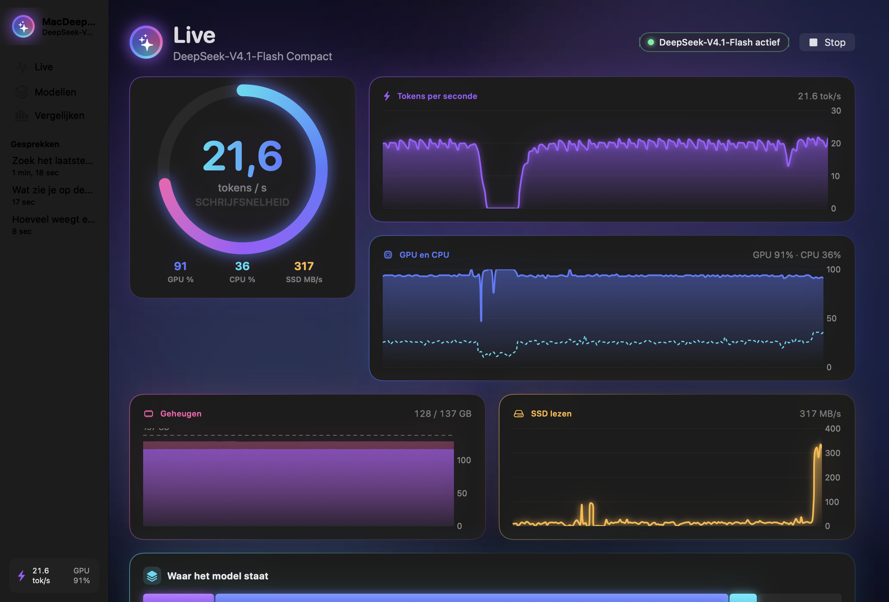
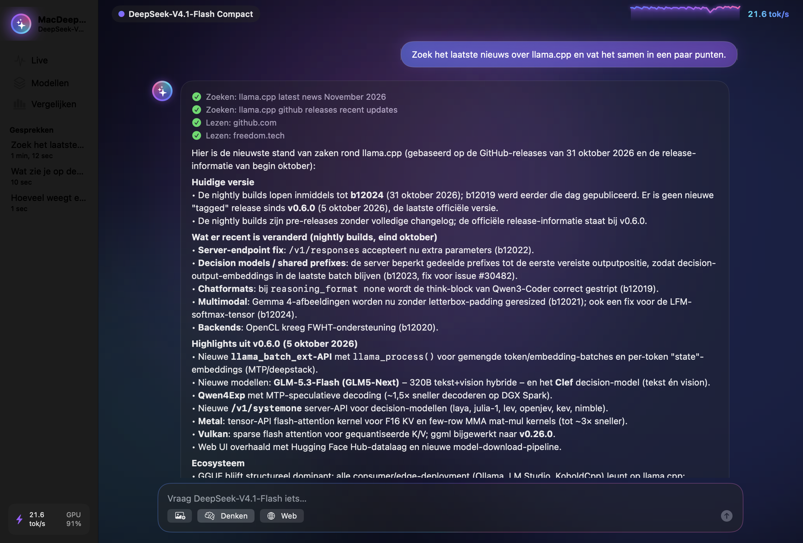
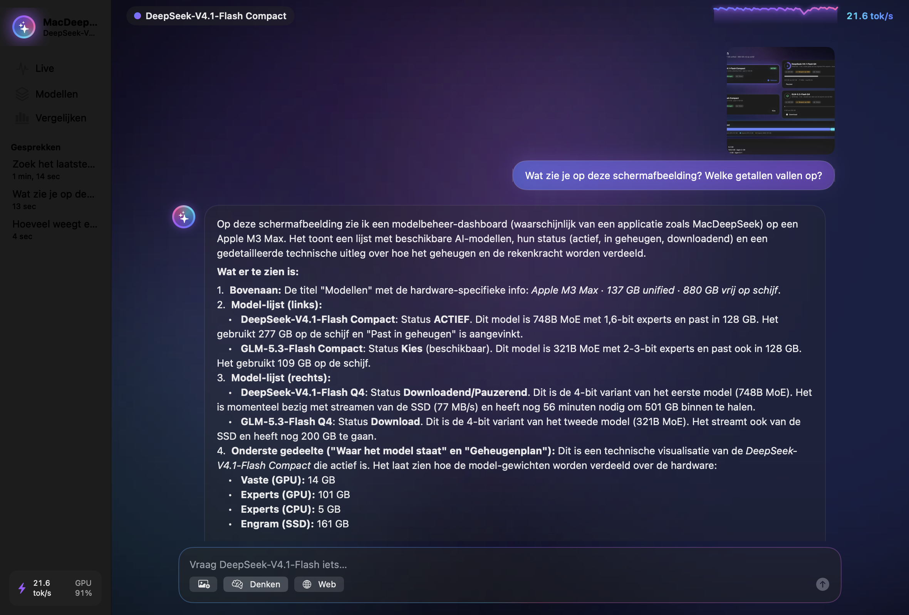
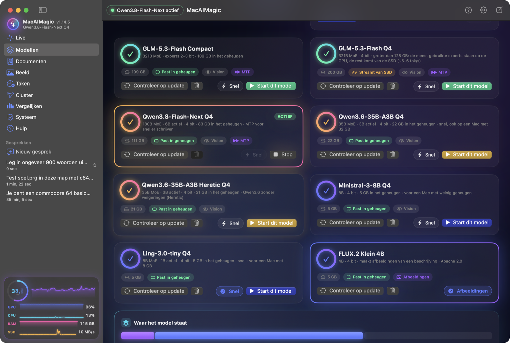
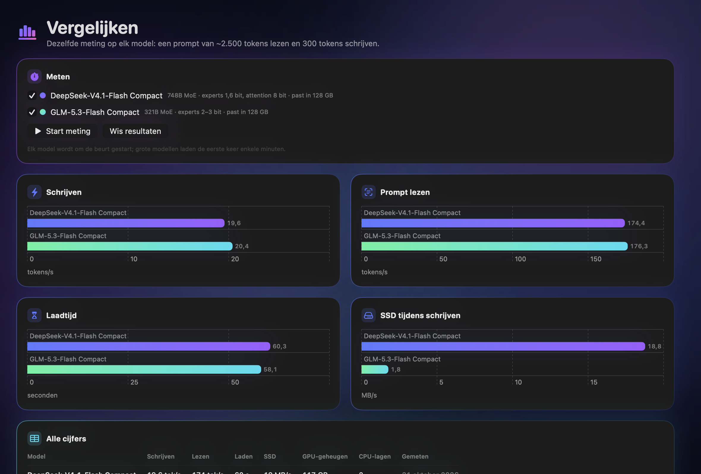
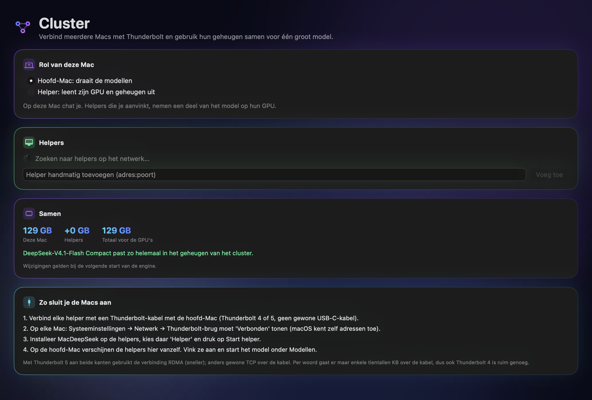

# MacAIMagic

Run **DeepSeek-V4.1-Flash-1017** (748B parameters), **GLM-5.3-Flash** (321B) and **Qwen3.8-Flash-Next** (180B), some
of the largest open mixture-of-experts models, fully locally on an Apple Silicon Mac with 128 GB of unified memory.
MacAIMagic is a native macOS app with live performance charts. You can chat with the models, upload images, let them
search the web, **let them work in a folder** (read and write files, run scripts, read logs), compare them side by side,
and use them as an OpenAI- or Anthropic-compatible API (for example from Claude Code).



> All screenshots show real answers and real measurements on a MacBook Pro M3 Max (128 GB).
> The app speaks English, German, French and Dutch (Settings → Taal / Language; at first your Mac's language).

## Models

| Model | Download | In memory | Writing | Prompt reading |
|---|---|---|---|---|
| **Qwen3.8-Flash-Next Q4**: 180B MoE, 6B active, 4 bit, MTP | 116 GB | fits (83 GB) | **33 tok/s, 40–55 with MTP** | ~440 tok/s |
| **GLM-5.3-Flash Compact**: 321B MoE, experts 2–3 bit, MTP | 110 GB | fits (109 GB) | **20 tok/s, 25–29 with MTP** | ~175–185 tok/s |
| **DeepSeek-V4.1-Flash Compact**: 748B MoE, experts 1.6 bit, attention 8 bit | 278 GB | fits (115 GB) | **19.6–20.1 tok/s** | ~160–175 tok/s |
| **GLM-5.3-Flash Q4**: 4 bit | 201 GB | ~95 GB of experts cached on the GPU, the rest read from the SSD | **5–6 tok/s** | ~70–100 tok/s |
| **DeepSeek-V4.1-Flash Q4**: 4 bit, close to the original FP4 experts | 460 GB | ~95 GB of experts cached on the GPU, the rest read from the SSD | **7–8.5 tok/s** | ~65–95 tok/s |
| **Qwen3.6-35B-A3B Q4**: 35B MoE, 3B active, 4 bit; the model for a Mac with 32 GB | 23 GB | fits (22 GB) | **60–67 tok/s** | ~180 tok/s (short prompt) |
| **Ministral-3-8B Q4**: 8B, 4 bit, reads images; the model for a Mac with 8 or 16 GB | 6 GB | fits (5 GB) | not measured on a Mac yet | not measured on a Mac yet |

Measured on a MacBook Pro **M3 Max, 128 GB**, macOS 27, with 64K context, vision on, and the default macOS GPU memory
limit. *Writing* is decode speed. *Prompt reading* is prefill speed on a 2,500-token prompt. The MTP ranges go from
creative text (low end) to code (high end); see [docs/RESEARCH.md](docs/RESEARCH.md). The Q4 rows are measured with the
GPU limit raised to 120 GB (the button under **Modellen**); their ranges go from a cold start to a warm one (the expert
cache saved by the previous run).

- **Compact** versions keep everything a token needs in memory. They are the fast choice. Measured against their Q4
  versions, both compact versions pick the same next token 84% of the time.
- **MTP** (multi-token prediction): GLM and Qwen have a small head that guesses the next tokens; the model checks them in
  one pass. The answers stay exactly the same, and writing gets up to 65% faster.
- **Q4** versions are close to the original weights, but larger than 128 GB. The GPU keeps the experts a conversation
  uses most (~95 GB); the others come from the SSD when a token needs them, with many parallel reads (6 GB/s). The cache
  is saved when the engine stops and loaded back at the next start, so the first answer is fast too. On a cluster of
  Macs more of the model stays in memory (see [docs/RESEARCH.md](docs/RESEARCH.md)).

## Why a Mac

Projects like [PolyStrata](https://github.com/VecSzn/PolyStrata) run very large MoE models on PCs with limited video
memory. They keep the busiest experts on the GPU and the rest in RAM or on the SSD, and copy experts across the PCIe
bus as needed. None of them runs these models on a Mac.

A Mac doesn't need that split. CPU and GPU share one pool of unified memory, so on a 128 GB Mac a whole compact model
(110–115 GB) stays in memory and the GPU reads it directly. Nothing is copied to a video card. For models larger than
memory, the GPU keeps a fixed set of layers, and macOS's page cache holds the experts that are actually used. The rest
comes from the internal SSD.

## Screenshots

| Chat with web search | The model reads an image |
|---|---|
|  |  |

| Models | Side-by-side comparison |
|---|---|
|  |  |

## Features

- **Live dashboard**: a speed gauge and real-time charts of tokens/s, GPU and CPU load, memory and SSD reads, and a mini version of it at the bottom of the sidebar
- **Seven models**, each with a download card (resumable, sha256-checked), a memory plan and one-click start. Each card
  says for this Mac whether the model fits in memory, streams from the SSD, or is too big. Every download address names
  one version of its file, and the size is checked before a byte comes down: when a maker replaces or removes a file,
  the card says so at once. Every Monday a GitHub job (`tools/check_catalog.py`) checks that every file can still be
  downloaded, reading headers only.
- **Images** (sidebar → **Beeld**): describe what you want and FLUX.2 Klein 4B (5.3 GB, Apache 2.0) makes the image on
  this Mac, with earlier ones below it. Images go to `~/Pictures/MacAIMagic` with their description in a file beside
  them, not inside the image. A running chat model stops first. The image engine is built with
  `scripts/build_image_engine.sh`; this page has not been run with the real engine on a Mac yet.
- **Documents**: make Word documents without cloud AI (sidebar → **Documenten**). A project is a folder with attachments
  (context and information), a house style (only the layout) and its documents. Say "make an AQS": the model looks in the
  attachments for what the document must consist of, searches the web for what they do not say, such as the subject and
  regulations, and writes a Markdown draft with numbered sources, where you change all text. The `.docx` comes last, in
  your house style: cover, headers and footers, numbered headings, table look and table of contents. What the cover needs
  is entered once per project. A fast model does the small work (notes per page, spelling), a heavy one the writing; on a
  Mac where two do not fit, one model does everything.
- **Works out the Mac it runs on**: the system check at every start (sidebar → **Systeem**) checks the engine, the
  download tools, the models, disk space, the GPU limit and Apple's developer tools; it lifts macOS's quarantine block
  on the engine by itself and offers the rest with one button. It recommends the best model that fits whole in this
  Mac's memory (128 GB: DeepSeek-V4.1-Flash Compact, 96 GB: Qwen3.8-Flash-Next, 32 GB: Qwen3.6-35B-A3B), or the role of
  cluster helper when none fits. Larger models stay available and stream from the SSD, also on 32 GB (see
  [the measurements](docs/RESEARCH.md#7-models-larger-than-memory-on-a-mac-with-32-gb)). On a Mac with little memory the
  app shrinks the context to what still fits and turns vision off when it would push the model out of memory.
- **Learns from its mistakes**: a work folder gets a `MACAIMAGIC.md` when it has none. After a task of a few steps the
  model says what it established (commands and paths that worked, what failed and why) and the app adds that under
  *Geleerd*, so a next conversation in that folder knows it. Skipped after a task that read the web; you can edit the
  file, and turn this off in Settings.
- **Works until the task is done**: when a model ends its turn without finishing (it announces a step and stops, only
  thinks, or leaves a tool call behind in its thinking), the app tells it to go on, and shows that in the chat. A cut-off
  answer goes on too, and a long task with a single question is summarized when the context fills up.
- **Compare**: measure every downloaded model the same way and see the results side by side
- **Cluster**: link several Macs with Thunderbolt and use their memory together. A helper Mac lends its GPU (llama.cpp
  RPC) and announces itself with Bonjour; the main Mac finds it, and the model's layers are spread over all GPUs in
  proportion to their memory. See [Cluster](#cluster).
- Streaming chat with markdown and code blocks (with a copy button)
- **Thinking** on/off, with a collapsible chain of thought, a reasoning-effort setting and a limit on thinking
  (16,000 tokens by default), after which the model writes its answer
- **Work in a folder**: choose a folder per chat (shown at the top of the chat) and the model can list, read, write and edit files there (also binary files,
  such as a C64 `.prg`), run commands and scripts, and read the end of log files. Everything stays inside that folder;
  what the model may do is set in a rights matrix: **L S U** (read, write, run) next to the folder button, each Allow, Ask first or Deny (default: reading is allowed, writing and running ask first; a question offers Allow, Deny, or Always in this conversation). A `MACAIMAGIC.md` in the folder is passed to the model as notes for that folder (like `CLAUDE.md` for Claude Code), for example how to start an emulator; general notes for every conversation go in `~/Library/Application Support/MacAIMagic/MACAIMAGIC.md` (Settings → Chat → Open bestand). Both are read again for every message. Programs with a window are started detached, so the command's time-out does not close them.
- **Languages**: English, German, French or Dutch, chosen in Settings and at first taken from macOS; the model gets its instructions in the same language.
- **Context**: a meter at the top of the chat shows how much of the model's context a conversation takes (64K by default, up to 1M for DeepSeek and GLM, 256K for Qwen). At 80% the start of the conversation is summarized by the model and sent as a summary instead (the messages stay visible, with a marker); there is also a button to do it now.
- **Images**: button, drag and drop, or paste (⌘V, also while typing: screenshots, copied images, image files from the Finder)
- **Web search**: the model calls `web_search` and `fetch_url` by itself. The app runs them (DuckDuckGo, or Brave Search
  with your own API key) and shows each step and the sources.
- Conversations are saved locally
- The Mac stays awake while the engine runs (the display may still sleep), so long answers and benchmarks don't freeze
- Local API on `http://127.0.0.1:8080`: OpenAI (`/v1`), Anthropic (`/v1/messages`) and Responses (`/v1/responses`)

## Requirements

- Apple Silicon Mac (M1 or later). Models that do not fit in memory stream from the SSD: with **128 GB** the compact
  models fit whole (tested on M3 Max); with 96 GB Qwen3.8-Flash-Next fits whole; with 32 GB Qwen3.6-35B-A3B fits whole
  and the others stream. Any Mac can be a cluster helper. The app works this out itself (see the system check above).
- macOS 14 or later
- Disk space: 23–502 GB per model (see the table above)
- No developer tools, Python or Homebrew needed to run the app
- To build from source: Xcode Command Line Tools and CMake (`brew install cmake`)

## Installation

### 1. Get the app

The release build is signed with a Developer ID and notarized by Apple, so it opens without a warning. Download the zip
from the [Releases page](https://github.com/mfidder2026/MacAIMagic/releases) or [`RELEASE/`](RELEASE/), unzip it and move
`MacAIMagic.app` to `/Applications`. Or install it from Terminal:

```sh
curl -L https://github.com/mfidder2026/MacAIMagic/releases/latest/download/MacAIMagic-macOS-arm64.zip -o /tmp/MacAIMagic.zip && ditto -x -k /tmp/MacAIMagic.zip /Applications && open /Applications/MacAIMagic.app
```

Or build the app yourself (see below).

### 2. Download one or more models

The models are **not** included in this repository. Each one is several GGUF files plus an optional vision file. There
are three ways to get them:

- **In the app:** Modellen → **Download** on a model's card. It downloads in parallel, resumes after interruptions and
  checks every file's sha256.
- **With the script:** `tools/download_model.sh <model-id> [folder]`, for example
  `tools/download_model.sh glm-5.3-flash-compact`.
- **By hand:** the download URLs, file names, sizes and checksums are in [`tools/models.json`](tools/models.json).

Put each model in its own folder named after its id, and the vision files in `vision/`:

```
models/
├── deepseek-v4.1-flash-compact/   deepseek-v4.1-flash-compact-00001-of-00005.gguf …
├── glm-5.3-flash-compact/         glm-5.3-flash-compact-00001-of-00004.gguf …
├── qwen3.8-flash-next-q4/         qwen3.8-flash-next-q4-00001-of-00004.gguf …, qwen3.8-flash-next-mtp.gguf
└── vision/                        deepseek-v4.1-vision.gguf, glm-5.3-vision.gguf, qwen3.8-vision.gguf
```

The default location is `~/Library/Application Support/MacAIMagic/models/`. To use another folder, choose it in the app
under Modellen → Modelmap → **Kies map…**.

### 3. Start

Open the app, choose a model under **Modellen** and press **Start**. Close large programs first, because a compact model
uses about 115–120 of the 128 GB. Optionally, press **Verhoog GPU-limiet** to let the GPU wire more memory. This runs
`sysctl iogpu.wired_limit_mb`, asks for your password, and lasts until the next restart.

## Building from source

```sh
git clone https://github.com/mfidder2026/MacAIMagic.git
cd MacAIMagic
brew install cmake
./scripts/build_engine.sh     # fetches llama.cpp at a pinned commit, applies the patch, builds with Metal (~5 min)
./scripts/make_app.sh         # builds dist/MacAIMagic.app with the engine inside
open dist/MacAIMagic.app
```

Run the engine without the app: `./scripts/run_engine.sh <model-id> [cpu-moe-layers]`. Then benchmark it with
`python3 tools/bench.py`.

To measure quality, compare a compact model with its Q4 version (next-token agreement and KL divergence):
`tools/quality.sh deepseek` or `tools/quality.sh glm`.

Tests: `cd App && swift test`. The engine tests run only when you ask for them:
`MACAIMAGIC_ENGINE_TEST=1 swift test` with the engine running, or `MACAIMAGIC_BENCH=<ids> swift test` with it stopped.

## Cluster

With several Macs, one is the **main Mac** (you chat there) and the others are **helpers** that hold part of the model
on their GPU. Per token only a layer's output travels between the Macs (a few tens of KB), so a Thunderbolt cable is
plenty: tested on one Mac with a local helper, splitting GLM-5.3-Flash Compact in half cost 7% writing speed (20.4 →
19.0 tok/s) and nothing in prompt reading.

1. Connect each helper to the main Mac with a Thunderbolt cable (System Settings → Network → Thunderbolt Bridge shows
   Connected).
2. On each helper: open MacAIMagic → **Cluster** → role **Helper** → **Start helper**. The helper only listens on the
   Thunderbolt bridge unless you allow the local network; llama.cpp's RPC has no password, so use a direct cable or a
   trusted network.
3. On the main Mac: **Cluster** shows the helpers with their chip and memory. Tick the ones to use, then start a model.
   Each helper takes as many whole layers as its GPU holds (the first layers); the main Mac keeps the rest. If those do
   not fit in its memory, it keeps them mapped from the SSD with the expert cache, like a single Mac.
4. On a helper, **Verhoog GPU-limiet** lets its GPU hold ~88 GB of a 96 GB Mac instead of ~72 GB, so it takes more layers.

The first start sends each helper its layers over the cable; a helper keeps them in `~/Library/Caches/llama.cpp/rpc`
(as much disk space as its share of the model), so the next start is faster. Delete that folder to free the space.

Example: a MacBook Pro M3 Max (128 GB) with a Mac Studio M5 (96 GB) and a Mac Studio M1 (32 GB) gives ~256 GB. GLM-5.3-Flash
Q4 (200 GB) then fits in memory. DeepSeek-V4.1-Flash Q4 does not quite: the helpers take ~11 layers, and the main Mac
caches almost half of the experts of its 29 layers instead of a third of all 40. Between two Thunderbolt 5 Macs the connection
uses RDMA; otherwise it is TCP over the cable.



## Using the API

While the engine runs, other programs can use the model:

```sh
# Claude Code with the local model
ANTHROPIC_BASE_URL=http://127.0.0.1:8080 claude

# any OpenAI-compatible client
curl http://127.0.0.1:8080/v1/chat/completions -H 'Content-Type: application/json' \
  -d '{"messages":[{"role":"user","content":"Hello!"}]}'
```

The API listens on this Mac only. To reach it from other machines, set the address to `0.0.0.0` **and** an API key in
the settings.

## How it works

**Engine.** [llama.cpp](https://github.com/ggml-org/llama.cpp), pinned to commit `ddf48f8`, which supports
`deepseek41`, `glm5-next` and `qwen4exp` (Qwen3.8-Flash-Next) natively, built with Metal. MacAIMagic adds two patches:

[`patches/0001-deepseek41-split-engram.patch`](patches/0001-deepseek41-split-engram.patch) lets it load DeepSeek GGUFs that
store the Engram n-gram tables differently:

- the Engram metadata is named `engram.*` instead of `ple.*`, with the bucket counts stored as u32;
- the tables are split into one tensor per Engram layer, with local offsets;
- the `hash_layer_count` key is missing. V4.1 has no hash layers, so it now defaults to 0;
- `LLAMA_MMAP_PREFETCH=0` turns off the read-ahead of the whole file at load, which for a model larger than memory reads
  hundreds of GB and evicts itself.

[`patches/0002-fast-expert-streaming.patch`](patches/0002-fast-expert-streaming.patch) makes models larger than memory
usable. llama.cpp can keep the experts used most in a GPU cache (`--moe-cache-mib`), but it read every missing expert
through page faults on one thread, at 0.8 GB/s. The patch:

- reads with a pool of 16 threads in 1 MiB chunks, one `madvise(WILLNEED)` request each: the SSD delivers 6.5 GB/s;
- writes the missing experts straight into the GPU cache (unified memory), and copies the experts prompt reading needs
  the same way, reading the next layer's experts while the GPU computes the current one;
- guesses the experts of the next layer by applying its router to the input of the current one, and reads the two best
  guesses that are not cached while the GPU computes (half of the misses are read ahead this way);
- saves which experts are in the cache when the engine stops, and loads them back at the next start, so the first answer
  is as fast as the later ones.

**Memory plan.** The app reads the GGUF headers and decides where each part goes:

| Part | Where |
|---|---|
| Dense weights (attention, shared experts, router, hyper-connections) | GPU |
| Routed experts, model fits in memory | GPU, as many layers as fit under the GPU limit; the first layers run on the CPU from memory |
| Routed experts, model larger than memory (Q4) | mapped from the SSD; ~100 GB of the GPU caches the experts the conversation uses most, and the GPU computes all of them |
| DeepSeek's Engram tables (161–203 GB) | SSD; a few rows per token are read on demand |
| KV cache and compute buffers | GPU |

**Tuning.** `--ubatch-size 1024` reads prompts about 20% faster than the default of 512 for the models that fit. 2048
makes the compute buffers too big for them: memory overflows and writing drops from 20 to 3 tokens/s. Models larger than
memory read their uncached experts from the SSD once per batch, so they use 4096: a 2,500-token prompt in one pass, 35–65%
faster than with 2048. Batches of up to 8 tokens read their experts from the cache; larger ones copy the experts they use
without pushing the conversation's experts out of it.

## Project layout

```
App/          SwiftUI app (Swift package) and tests; App/Sources/MacAIMagic/Documents holds the Word engine
patches/      llama.cpp patches and pinned commit
scripts/      build_engine.sh, make_app.sh, run_engine.sh, stop_engine.sh, make_icon.swift
tools/        models.json, download_model.sh, bench.py, speed_mix.py, stream_bench.py, stream_tune.sh, quality.sh, gguf_peek.py
docs/         screenshots, research notes, Dutch README
RELEASE/      ready-made app build
```

## Research

[docs/RESEARCH.md](docs/RESEARCH.md) has the measurements behind these choices: what MacAIMagic learned from MTPLX
(speculative decoding with MTP), how the Q4 versions went from 2–3 to 5–8.5 tok/s on one 128 GB Mac (and what did not
help), and how several Macs are linked into one large memory.

## Roadmap

- Measure the cluster on real hardware (M3 Max + M5 + M1) and tune how the layers are split
- Faster prompt reading for models that fit (Metal kernels for low-bit experts at large batch sizes)
- Switch models within one conversation (a fast model for routine work, a large one for hard problems)

## Credits and licenses

MacAIMagic is MIT-licensed (see [LICENSE](LICENSE)). It builds on:

- [llama.cpp / ggml](https://github.com/ggml-org/llama.cpp) (MIT): the inference engine, bundled in the release build
- [DeepSeek-V4.1-Flash-1017](https://huggingface.co/deepseek-ai/DeepSeek-V4.1-Flash-1017) (MIT), by DeepSeek
- [GLM-5.3-Flash](https://huggingface.co/zai-org/GLM-5.3-Flash) (MIT), by Z.ai
- [Qwen3.8-Flash-Next](https://huggingface.co/Qwen/Qwen3.8-Flash-Next), by Qwen (its own license, see the model page)
- The quantized GGUF files are downloaded from Hugging Face from their publishers; see [`tools/models.json`](tools/models.json)

See [THIRD_PARTY_NOTICES.md](THIRD_PARTY_NOTICES.md).
