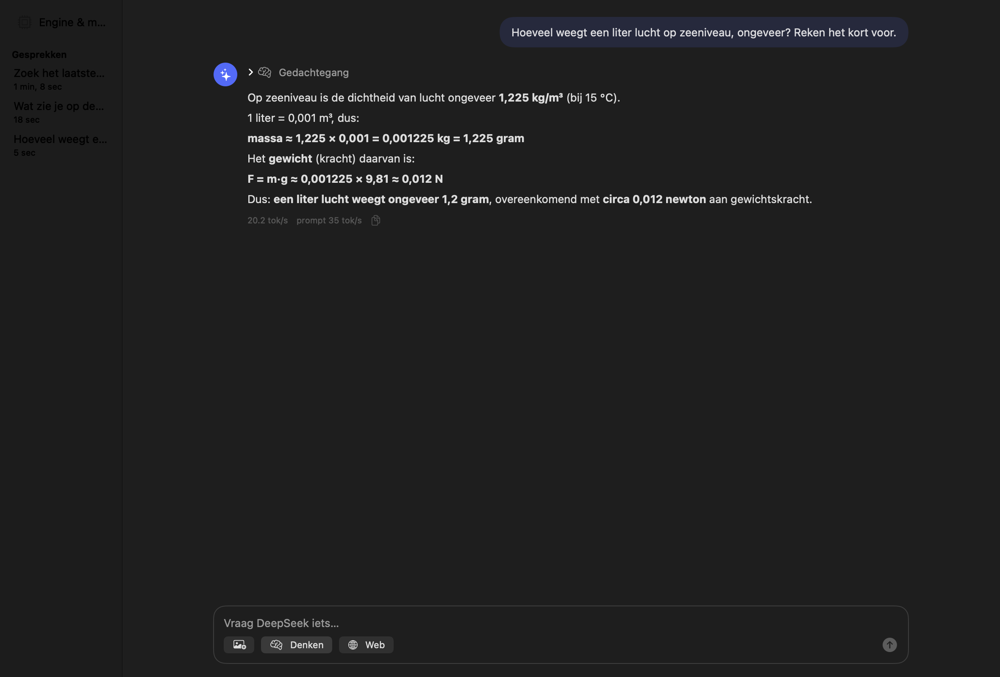
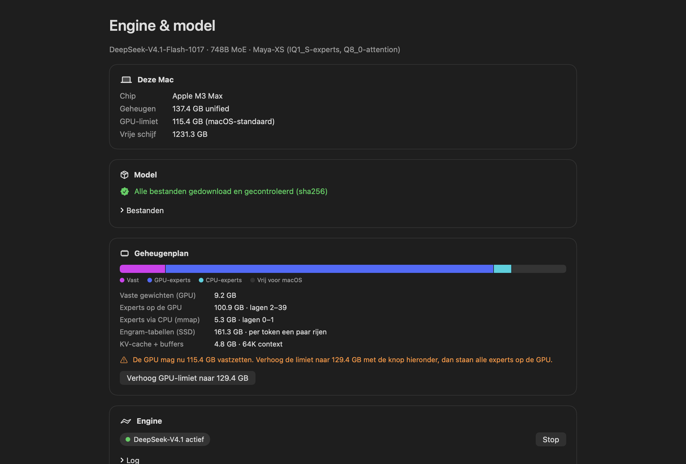
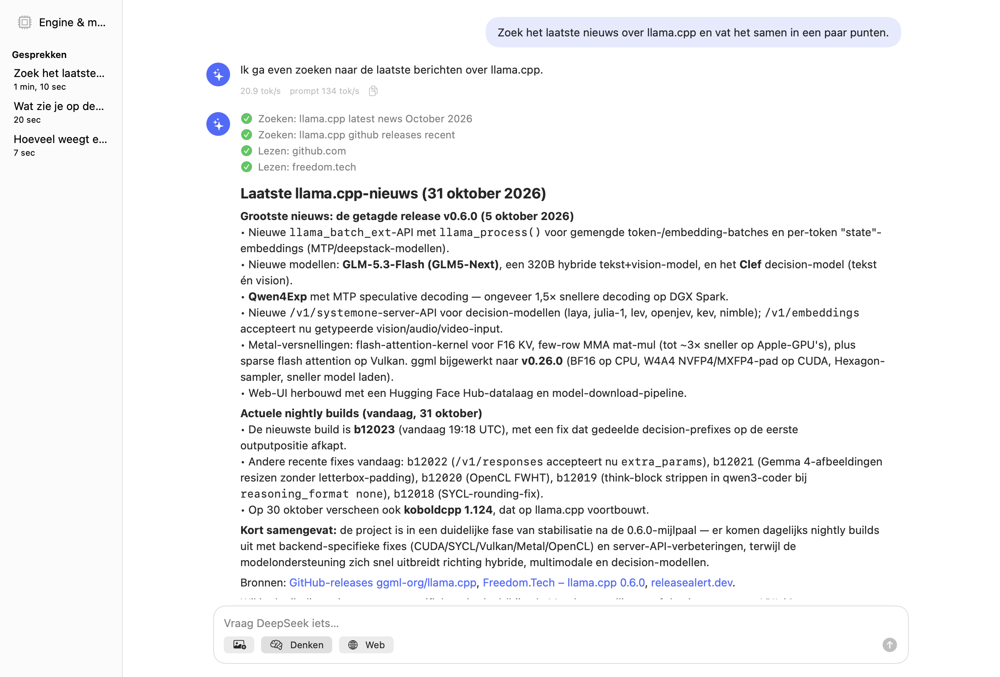

# MacDeepSeek

Run **DeepSeek-V4.1-Flash-1017** (748B-parameter mixture-of-experts) fully locally on an Apple Silicon Mac with
128 GB of unified memory, in a native macOS app. You can chat with it, upload images, let it search the web, and
use it as an OpenAI- or Anthropic-compatible API (for example from Claude Code).


> All screenshots show real answers from the model, running on a MacBook Pro M3 Max (128 GB).
> The app's interface is in Dutch for now.

## Why this exists

[PolyStrata](https://github.com/VecSzn/PolyStrata) and [Project Maya](https://github.com/mw00/project-maya) run
very large MoE models on PCs with limited video memory. They keep the busiest experts on the GPU and the rest in RAM
or on the SSD, and copy experts across the PCIe bus as needed. Neither runs DeepSeek-V4.1-Flash on a Mac.

A Mac doesn't need that split. CPU and GPU share one pool of unified memory, so on a 128 GB Mac the whole
quantized model (115 GB) can stay in memory and the GPU reads it directly. Nothing is copied to a video card. That is
the core of MacDeepSeek.

| | PolyStrata | Project Maya | MacDeepSeek |
|---|---|---|---|
| Platform | Windows / Linux | Linux / Windows | **macOS (Apple Silicon)** |
| DeepSeek-V4.1-Flash-1017 | no (V4 Flash only, Linux) | yes, NVIDIA / AMD only | **yes, Metal** |
| Mac support | Qwen3.8 only | experimental, GLM-5.3 only | primary target |

## Performance

Measured on a MacBook Pro **M3 Max, 128 GB**, macOS 27, with the Maya-XS model, 64K context, vision on, and the default
macOS GPU memory limit:

| | Speed |
|---|---|
| Writing (decode) | **19–21 tokens/s**, also with thinking on |
| Reading the prompt (2,600 tokens) | **~160 tokens/s** (about 16 s) |
| Image (≈200 tokens) | ~2 s |
| Start-up | ~1 min the first time, ~8 s after that (weights stay in the page cache) |
| Web search question (search, read 2 pages, answer) | 1–2 min |
| Memory | 115 GB wired for the GPU, ~10 GB left for macOS |

What we found while tuning:

- `--ubatch-size 1024` reads prompts about 20% faster than the default of 512.
- `--ubatch-size 2048` makes the compute buffers too big. Memory overflows and writing drops from 20 to 3 tokens/s.
- Keeping the experts of 4 layers on the CPU instead of 2 costs about 10%. Moving all of them to the GPU would only make
  prompt reading slightly faster.
- Reading long prompts is the weak spot: a 10,000-token web page takes about a minute.

## Screenshots

| Images | Thinking |
|---|---|
|  |  |

| Engine & model dashboard | Light mode |
|---|---|
|  |  |

## Features

- Streaming chat with markdown and code blocks (with a copy button)
- **Thinking** on/off, with a collapsible chain of thought and a reasoning-effort setting
- **Images**: button, drag and drop, or paste (⌘V); scaled down to 1344 px for the vision tower
- **Web search**: the model calls `web_search` and `fetch_url` by itself. The app runs them (DuckDuckGo, or Brave Search
  with your own API key) and shows each step and the sources.
- Conversations are saved locally
- Dashboard: model download (resumable, sha256-checked), memory plan, engine start/stop, log
- Local API on `http://127.0.0.1:8080`: OpenAI (`/v1`), Anthropic (`/v1/messages`) and Responses (`/v1/responses`)

## Requirements

- Apple Silicon Mac with **128 GB** unified memory (tested on M3 Max). Smaller Macs are not supported: the model alone
  needs 115 GB.
- macOS 14 or later
- About **280 GB** of free disk space for the model
- To build from source: Xcode Command Line Tools and CMake (`brew install cmake`)

## Installation

### 1. Get the app

Either download the ready-made build from [`RELEASE/`](RELEASE/), or build it yourself (see below).

The release build is ad-hoc signed, not notarized. The first time, right-click the app and choose **Open**, or run:

```sh
xattr -dr com.apple.quarantine MacDeepSeek.app
```

### 2. Download the model

The model is **not** included in this repository. Download it yourself (278 GB in total):

| File | Size | Source |
|---|---|---|
| `DeepSeek-V4.1-Flash-1017-Maya-XS-IQ1_S-00001-of-00005.gguf` … `-00005-of-00005.gguf` | 276.6 GB | [peasantsmith/DeepSeek-V4.1-Flash-1017-Maya-GGUF](https://huggingface.co/peasantsmith/DeepSeek-V4.1-Flash-1017-Maya-GGUF/tree/main/Maya-XS) (folder `Maya-XS`) |
| `mmproj-F16.gguf` (vision, optional) | 1.0 GB | [unsloth/DeepSeek-V4.1-Flash-1017-GGUF](https://huggingface.co/unsloth/DeepSeek-V4.1-Flash-1017-GGUF/blob/main/mmproj-F16.gguf) |

Put all six files in one folder. You have three ways to do it:

- **In the app:** Engine & model → **Download model**. It downloads in parallel, resumes after interruptions and
  checks every file's sha256.
- **With the script:** `tools/download_model.sh [folder]` does the same from the terminal.
- **By hand:** download the files into any folder, then choose that folder in the app (Engine & model → Files →
  **Kies map…**).

The default folder is `~/Library/Application Support/MacDeepSeek/models/Maya-XS/`.

### 3. Start

Open the app, go to **Engine & model** and press **Start engine**. Close large programs first, because the model uses
about 120 of the 128 GB. Optionally, press **Verhoog GPU-limiet** to let the GPU wire more memory. This runs
`sysctl iogpu.wired_limit_mb`, asks for your password, and lasts until the next restart.

## Building from source

```sh
git clone https://github.com/mfidder2026/MacDeepSeek.git
cd MacDeepSeek
brew install cmake
./scripts/build_engine.sh     # fetches llama.cpp at a pinned commit, applies the patch, builds with Metal (~5 min)
./scripts/make_app.sh         # builds dist/MacDeepSeek.app with the engine inside
open dist/MacDeepSeek.app
```

Run the engine without the app (same settings): `./scripts/run_engine.sh`. Then benchmark it with
`python3 tools/bench.py`.

Tests: `cd App && swift test`. The engine tests run only when the engine is up: `MACDEEPSEEK_ENGINE_TEST=1 swift test`.

## Using the API

While the engine runs, other programs can use the model:

```sh
# Claude Code with the local model
ANTHROPIC_BASE_URL=http://127.0.0.1:8080 claude

# any OpenAI-compatible client
curl http://127.0.0.1:8080/v1/chat/completions -H 'Content-Type: application/json' \
  -d '{"messages":[{"role":"user","content":"Hello!"}]}'
```

The API listens on this Mac only. To reach it from other machines, set the address to `0.0.0.0` **and** an API key in
the settings.

## How it works

**Model.** DeepSeek-V4.1-Flash-1017 has 384 routed experts per layer (6 active per token), compressed sparse attention,
hyper-connections, and *Engram* n-gram memory tables. MacDeepSeek uses Project Maya's **Maya-XS** quantization, which is
made to fit in 128 GB. The routed experts are IQ1_S, and attention, shared experts, embeddings and output are Q8_0. It
picks the same top token as the original model 87.5% of the time.

**Engine.** [llama.cpp](https://github.com/ggml-org/llama.cpp), pinned to commit `ddf48f8`, which supports `deepseek41`
natively, built with Metal. On top of that, [`patches/0001-deepseek41-maya-engram.patch`](patches/0001-deepseek41-maya-engram.patch)
lets llama.cpp load Maya's GGUF files, which differ from what llama.cpp expects:

- Engram metadata is stored as `engram.*` instead of `ple.*`, with the bucket counts as u32 instead of u64.
- The Engram tables are two tensors (one per Engram layer, with local offsets) instead of one.
- The `hash_layer_count` key is missing. V4.1 has no hash layers, so it now defaults to 0.

**Memory plan.** The app reads the GGUF headers and decides where each part goes:

| Part | Size | Where |
|---|---|---|
| Dense weights (attention, shared experts, router, mHC) | 9.2 GB | GPU |
| Routed experts, 40 layers | 106.2 GB | GPU, as many layers as fit under the GPU limit; the rest run on the CPU from the page cache |
| Engram tables | 161.3 GB | SSD; a few rows per token are read on demand |
| KV cache and compute buffers (64K, vision) | ~4.8 GB | GPU |

## Project layout

```
App/          SwiftUI app (Swift package) and tests
patches/      llama.cpp patch and pinned commit
scripts/      build_engine.sh, make_app.sh, run_engine.sh, make_icon.swift
tools/        download_model.sh, bench.py, gguf_peek.py (reads GGUF headers, also over HTTP)
docs/         screenshots, Dutch README
RELEASE/      ready-made app build
```

## Roadmap

- Faster prompt reading (Metal kernels for IQ1_S experts at large batch sizes)
- GLM-5.3-Flash support, so both models can be compared side by side
- A higher-quality DeepSeek quant (Maya-S or Q4) that streams part of the experts from the SSD
- English interface

## Credits and licenses

MacDeepSeek is MIT-licensed (see [LICENSE](LICENSE)). It builds on:

- [llama.cpp / ggml](https://github.com/ggml-org/llama.cpp) (MIT): the inference engine, bundled in the release build
- [Project Maya](https://github.com/mw00/project-maya) (MIT): the Maya-XS quantization, and the idea of a memory plan for unified memory
- [PolyStrata](https://github.com/VecSzn/PolyStrata) (MIT): research into running large MoE models on limited hardware
- [DeepSeek-V4.1-Flash-1017](https://huggingface.co/deepseek-ai/DeepSeek-V4.1-Flash-1017) (MIT), by DeepSeek
- [Unsloth](https://huggingface.co/unsloth/DeepSeek-V4.1-Flash-1017-GGUF): the vision projector GGUF

See [THIRD_PARTY_NOTICES.md](THIRD_PARTY_NOTICES.md).
